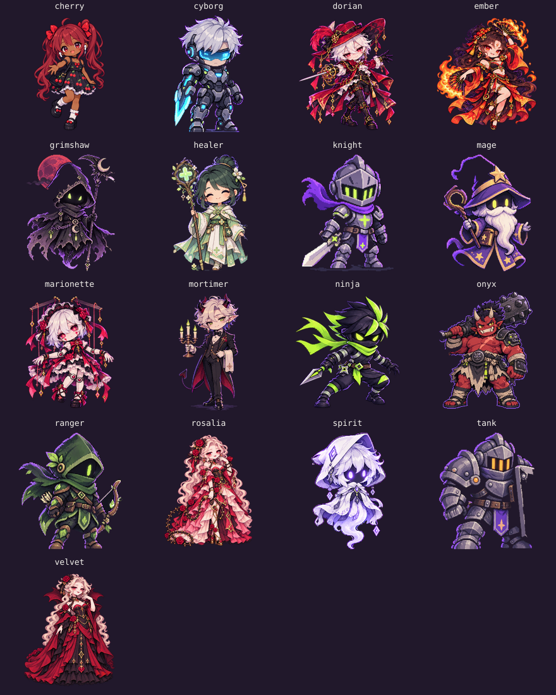
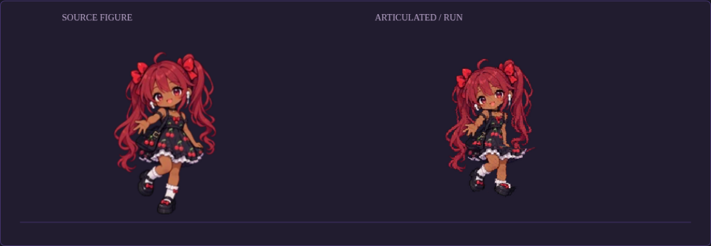
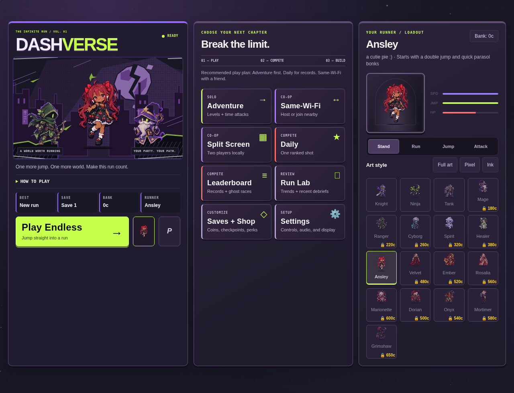

# Complete silhouettes and Ansley's complexion

This follow-up fixes two sources of cropping: incomplete source figures and fixed-size animation/menu frames. It also gives Ansley the deeper warm brown skin tone requested by the user, keeping her red twin-tails, cherry dress, earbuds, expression and character kit.

The repaired source figures are Ansley, Ninja, Dorian, Ember, Marionette, Velvet and Rosalia. Missing outer art was restored with the original figures as references, detached palette/scenery artifacts were removed, transparent clearance was added, and the skeletons were fitted to the complete figures. Velvet and Rosalia's full gown hems remain cloth rather than being split between leg bones.

Animation frames now include the deformed silhouette and rotated weapons. Their original world-space anchor is preserved; a 28 MiB byte ceiling keeps the shared frame cache bounded. The broad bottom-strip deletion was removed because it cut through boots, gown hems and low weapon tips.

Character selection fits the actual visible artwork over the entire selected action, keeping a stable scale as it animates. Mirroring preserves that framing, and the cover-party canvases fit the available cover height. Ink and Pixel retain Ansley's new complexion while white clothing and red accents keep their colors.

Use `npm run art:pack` after editing audited PNG figures. It packs the checked-in art without running segmentation or component deletion. The animation studio and offline mobile bundle were regenerated.

## Validation

- Full repository verification, including 1,014 unit tests.
- Browser clipping regression: all 17 characters, three art styles, both directions and 38px/124px previews; 9,792 preview checks and 3,332 internal frame checks with no clipped or empty frames.
- Browser gameplay: all 17 characters across idle, movement, jump, attack and dash, plus desktop/mobile menu layouts.
- Offline mobile game: all 17 characters through movement and jumping on the native message bridge.
- Production build and a final visual check of character selection and gameplay.

