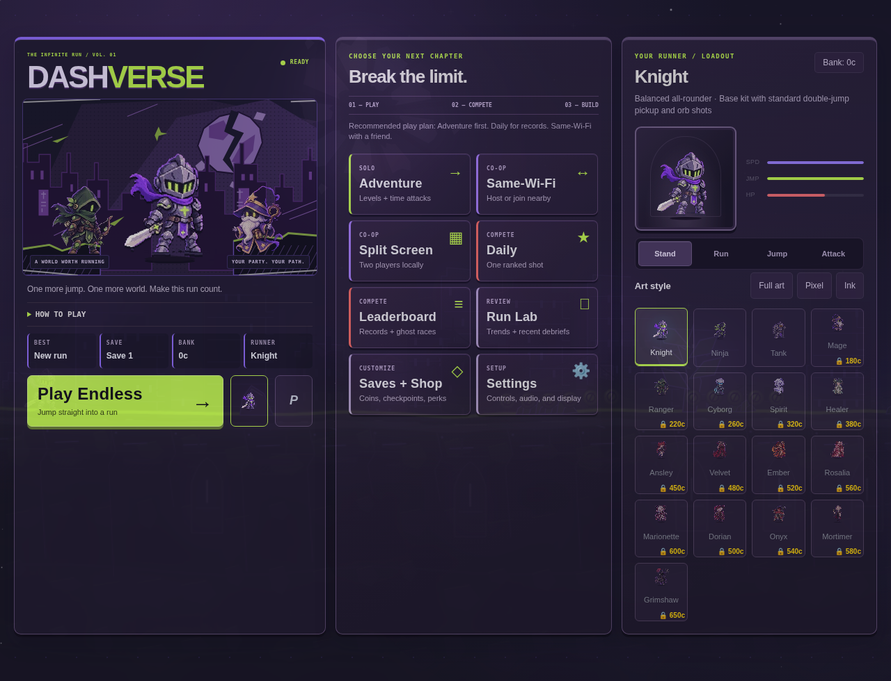
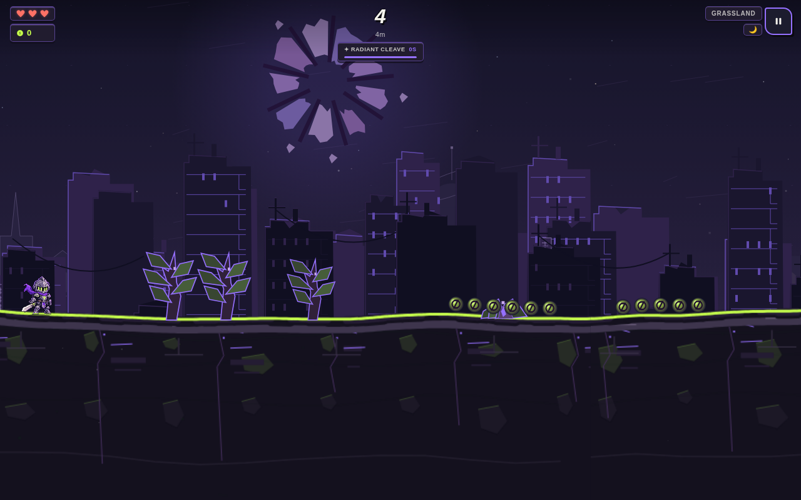
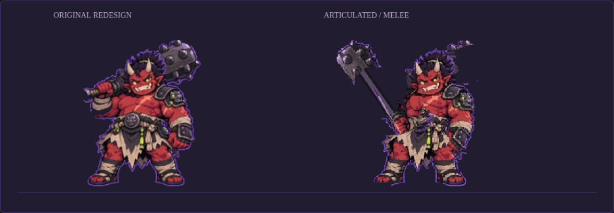

# Character performance and world polish

The 17 painted heroes retain their names, palettes, costumes, abilities, stats and unlocks. Their shared animation now has individual direction in `character-performance.ts`, used by live players, court enemies and the character-selection rehearsal controls.

| Characters | Movement direction |
| --- | --- |
| Knight | Balanced stride, controlled sword work, cape follow-through |
| Ninja | Fast low stride, forward commitment, light impact, trailing scarf |
| Tank, Onyx | Deliberate footfalls, restrained armor bounce, weighty overhead strikes |
| Mage, Healer | Quiet arms, stable staff carrying, soft robe motion and casting |
| Ranger | Light scouting gait, bow extension and draw-arm recoil |
| Cyborg | Measured mechanical steps, stable torso, minimal squash |
| Spirit, Grimshaw | Floating body and cloth motion; distinct casting and reaping gestures |
| Ansley | Buoyant steps and jumps, lively hair and an expressive bonk |
| Velvet, Rosalia | Composed upper bodies, graceful cloth, fan and whip gestures |
| Ember | Open arm rhythm, energetic steps and fan flourishes |
| Marionette | High recovery feet and deliberate doll-like arm articulation |
| Dorian | Forward rapier lunge with coat follow-through |
| Mortimer | Controlled steps and a steady candelabra hand |

The moonlit city now includes distant chapels, an observatory, ruined arches, cool stone bevels and restrained dust. Decorative scenery stays outside the bright traversal/collectible palette. Shadows stay at grounded feet, and melee effects use each hero's signature accent.

## Repairs

- Restore the complete Knight asset and its matching rig from the revision before the satellite scrubber deleted the torso, scarf and sword. Exclude Knight from those destructive component rules.
- Keep Onyx's face and hair out of the club mask. Render the club behind the body and continue its previously occluded shaft so a swing stays connected.
- Position court enemy artwork at the enemy's screen coordinates in either direction.
- Constrain unreachable foot targets before IK so calves retain their length.
- Include fall velocity, takeoff and landing in cached poses; retain speed on repeated render frames so pausing does not change posture.
- Coalesce image-load events in the standalone animation studio to avoid repeatedly baking the whole review sheet during startup.

## Review and validation

The selected runner has Stand, Run, Jump and Attack previews. The existing [animation studio](../../design/articulation/index.html) contains the full cast and pose sheet. The checked-in mobile WebView bundle was regenerated from the shared engine.

- `npm run verify`: passed, including 1,004 unit tests and the repository's engine, progression, multiplayer, mobile, accessibility and source-contract checks.
- `npm run build`: passed. Existing unused-variable warnings in `ink-crimson.ts` remain.
- Browser QA: 17 heroes, 85 render-bound idle/run/jump/attack/dash frames; style switching and 1280px/390px menu layouts; no page errors.
- Offline mobile WebView QA: all 17 heroes moved and jumped through the native message bridge; no page errors.
- Visual review: all 17 heroes across six poses, plus the repaired Knight and Onyx weapon/head separation.

